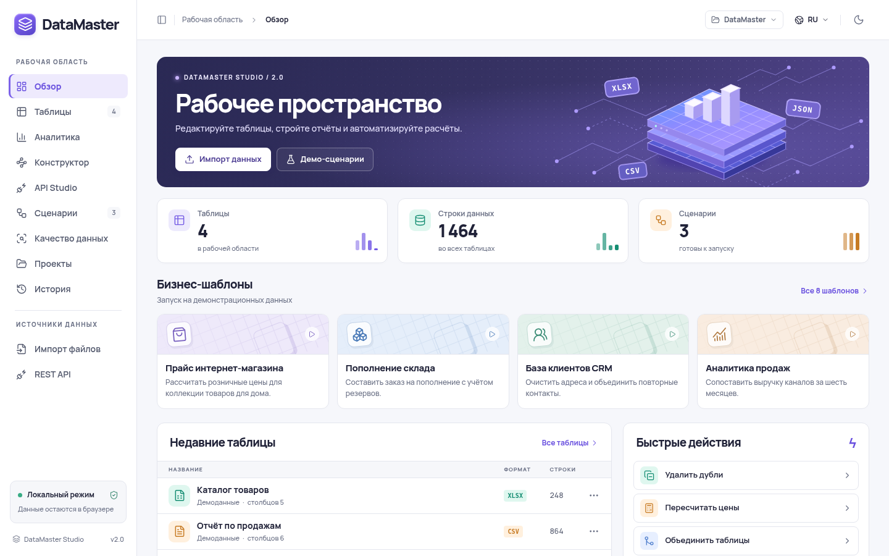

# DataMaster Studio 2.0

DataMaster помогает подготовить прайс, сверить поставки или собрать отчёт из нескольких выгрузок. Редактор таблиц, формулы, аналитика и конструктор сценариев работают в браузере. Для запуска достаточно современной версии браузера. Регистрация, серверное хранилище и платные API не требуются.



[Релиз 2.0.0](https://github.com/NikitaCreatorDeveloper/datamaster/releases/tag/v2.0.0) · [Скачать Offline](https://raw.githubusercontent.com/NikitaCreatorDeveloper/datamaster/downloads-v2.0.0/DataMaster-Offline.zip) · [Скачать сборку Cloudflare Pages](https://raw.githubusercontent.com/NikitaCreatorDeveloper/datamaster/downloads-v2.0.0/DataMaster-Cloudflare-Pages.zip) · [Галерея, видео и четыре текста для Kwork](docs/portfolio-v2/README.md)

## Первый прайс за минуту

1. Распакуйте Offline и откройте `DataMaster.html`. На главном экране нажмите **Прайс интернет-магазина**. В книге появятся исходный каталог и рассчитанный розничный прайс.
2. Найдите артикул **FM-101**. Закупочная цена кружки составляет 465 ₽. Нажмите её розничную цену, введите `=ROUND(D7*1.45,2)` и нажмите Enter. Вы получите 674,25 ₽.
3. Измените закупочную цену на 500 ₽. Зависимая ячейка пересчитается до 725 ₽. Выберите **Экспорт → XLSX**, затем импортируйте скачанный файл и проверьте значение и формулу.
4. Вернитесь в **Обзор → Аналитика продаж**. Сгруппируйте выручку по месяцу, выберите канал и скачайте график в PNG или отчёт в PDF.

Открытая сессия изначально хранится в памяти вкладки. Для продолжения на том же компьютере откройте **Проекты → Разрешить сохранение**. Для переноса на другое устройство используйте экспорт проекта в JSON.

## Возможности

| Раздел | Что можно сделать |
|---|---|
| Таблицы | Создать пустой лист, импортировать сразу несколько XLSX, CSV и JSON, скопировать, переименовать и удалить лист. Добавлять, удалять, перемещать и переименовывать столбцы, менять порядок строк, размеры и закрепление. |
| Редактор | Редактировать ячейки и диапазоны, вставлять данные из Excel и Google Sheets, протягивать последовательности и формулы. Доступны типы данных, шрифты, выравнивание, границы, цвета и правила для дублей, пустых ячеек и заданных значений. |
| Операции | Искать, заменять, фильтровать, сортировать, удалять дубли, считать цены, скидки и процент наценки. Перед применением доступен предпросмотр. Если у исходника есть формулы или оформление, обработка создаёт отдельный лист рассчитанных значений. |
| Объединение и сравнение | Добавлять строки, объединять записи по ключу и получать список добавленных, удалённых и изменённых полей. При пакетной обработке можно сопоставить столбцы с разными названиями. |
| Конструктор | Выбрать листы или пакет файлов, настроить и переставить шаги, нормализовать данные, разделить или соединить столбцы, посчитать прибыль, построить сводную и выгрузить результат. Доступны запуск до выбранного шага, журнал, прогресс, остановка и обмен сценариями в JSON. |
| Качество данных | Увидеть число полных дублей, пропусков и ошибочных форматов email, телефонов и дат. Отчёт показывает статистику по столбцам и первые 500 замечаний с координатами. Замечания выгружаются в CSV. |
| Аналитика | Группировать с разбивкой по второму полю, вычислять сумму, среднее, количество, минимум и максимум. Строить столбчатые, линейные и круговые диаграммы, фильтровать и сохранять настройки панелей. PDF содержит график, показатели и сводную. |
| API Studio | Выполнять GET, POST, PUT, PATCH и DELETE. Настраивать параметры, заголовки, JSON-тело, Bearer, Basic или API key. Просматривать статус, время, страницы и JSON. Вложенные записи разворачиваются в столбцы. Доступны ручное и периодическое обновление листа и сохранение схемы запроса. |
| Проекты и история | Вести несколько книг с панелями и сценариями, сохранять на устройстве с согласия владельца, восстанавливать рабочий экран и активный лист. Отменять и повторять табличные операции в текущей сессии. Скачать книгу со всеми листами можно в разделе **Проекты**. |

**Формулы.** Доступны арифметика, сравнения, ссылки A1 и диапазоны, SUM, AVERAGE, MIN, MAX, COUNT, IF, ROUND, COUNTIF, SUMIF, VLOOKUP и XLOOKUP. Собственный парсер вычисляет только допустимые выражения без `eval` и `new Function`. В первой строке книги находятся заголовки, данные начинаются с A2. Например, `=SUM(B2:B20)` складывает числовые ячейки. Для чисел, пришедших текстом из CSV, сначала задайте тип или примените нормализацию. [Совместимость и ограничения](docs/QA-2.0.md)

**Клавиатура.** Щелчок или F2 открывает ввод, Enter сохраняет, Esc отменяет ввод. Shift+клик или протягивание мышью выделяет диапазон. Ctrl/Cmd+C и V работают с табулированным текстом. Ctrl/Cmd+D заполняет выделение из верхней строки, Delete очищает, Ctrl/Cmd+F переводит фокус в поиск. Ctrl/Cmd+Z отменяет, Ctrl/Cmd+Shift+Z или Ctrl/Cmd+Y повторяет операцию. Кнопка с кистью заполняет выбранный диапазон одним значением.

## Бизнес-шаблоны

Каждая карточка создаёт новые рабочие листы с вымышленными данными. Изменения одного запуска не влияют на последующие.

| Шаблон | Результат |
|---|---|
| Прайс интернет-магазина | Розничные цены из себестоимости и наценки. |
| Пополнение склада | Доступный остаток и заявки на пополнение для дефицитных позиций. |
| База клиентов CRM | Контакты с нормализованными адресами без повторов и исходная выгрузка для сверки. |
| Аналитика продаж | Продажи, расходы, прибыль и заказы по периодам и каналам с переходом к отчёту. |
| Доходы и расходы | Финансовый результат по данным журнала операций. |
| Предложения поставщиков | Сопоставленные позиции двух поставщиков и сравнение предложений. |
| Доставки через API | В размещённом приложении выполняется GET к тестовому ресурсу этого сайта. Автономная сборка открывает встроенную копию того же набора и помечает источник. |
| Пакет Excel и CSV | Две выгрузки проходят создание и чтение XLSX/CSV, сопоставление и удаление повторной накладной. |

Три сценария из версии 1.0 также доступны в разделе **Сценарии**. Обновление прайса создаёт копию каталога из 248 товаров, очистка CRM оставляет 140 уникальных записей из 156, а отбор заказов выделяет оплаченные продажи.

## Локальные данные и API

- Файлы читаются в браузере через File API. Импорт, XLSX-экспорт, преобразования, сводные и крупные правки выполняются в Web Workers. У приложения нет серверных маршрутов загрузки, телеметрии или внешних шрифтов.
- Разрешение в **Проектах** включает IndexedDB для всех открытых проектов. Новая вкладка с устаревшей копией получает уведомление о конфликте при попытке перезаписи. Отключение сохранения с подтверждением удаляет сохранённую сессию.
- Язык, тема, явно сохранённые шаблоны API и параметры классических сценариев могут храниться в localStorage. Современные сценарии и панели входят в проект. До разрешения сохранения их можно забрать с собой через экспорт.
- Запрос идёт непосредственно к указанному получателю. Допустимые CORS-заголовки настраивает владелец API. Межсайтовые запросы требуют HTTPS. Cookies, Referer и автоматическая передача по перенаправлениям отключены. Для POST, PUT, PATCH и DELETE приложение запрашивает подтверждение перед каждой отправкой.
- Токен, пароль, тело запроса и значения заголовков живут в памяти экрана API. Шаблон содержит метод, домен, общие сегменты пути, имена полей и тип авторизации. При импорте ответа поля с признаками секретов и отражённые значения авторизации очищаются. Локально экспортированный проект содержит рабочие данные в открытом JSON.

## Запуск и публикация

Требуется Node.js 22.12 или новее. Исходный код использует React, TypeScript, Vite, Tailwind CSS, ExcelJS, Papa Parse, Chart.js, jsPDF и IndexedDB. Зависимости зафиксированы в `package-lock.json`.

```sh
npm ci
npm run dev
```

```sh
npm run build
npm run preview
npm run package:offline
npm run package:pages
```

Автономная сборка помещает интерфейс, шрифты и обработчики в один HTML. Команды сборки также создают архивы в каталоге `release/`. Cloudflare Pages принимает готовый ZIP или собирает ветку `main` командой `npm run build` с выходным каталогом `dist`. [Инструкция публикации](docs/CLOUDFLARE.md)

## Проверка

```sh
npm test
npm run build
npx playwright install chromium
npm run test:e2e
npm run test:offline
```

При использовании системного Chromium задайте `CHROMIUM_PATH`. Браузерные тесты используют OpenSSL для локального HTTPS и утилиту `pdftotext` из Poppler для проверки кириллицы в PDF. Сценарий съёмки портфолио использует FFmpeg. [Результаты и известные ограничения](docs/QA-2.0.md) · [Повторная съёмка](docs/portfolio-v2/README.md)

**Версии.** Исходное состояние сохранено тегом `backup/v1-before-studio-2`. Версия 2.0 разработана в ветке `feature/datamaster-studio-2`. Снимки интерфейса 1.0 сохранены в `docs/screenshots/`. [Предыдущий релиз 1.0.0](https://github.com/NikitaCreatorDeveloper/datamaster/releases/tag/v1.0.0)
