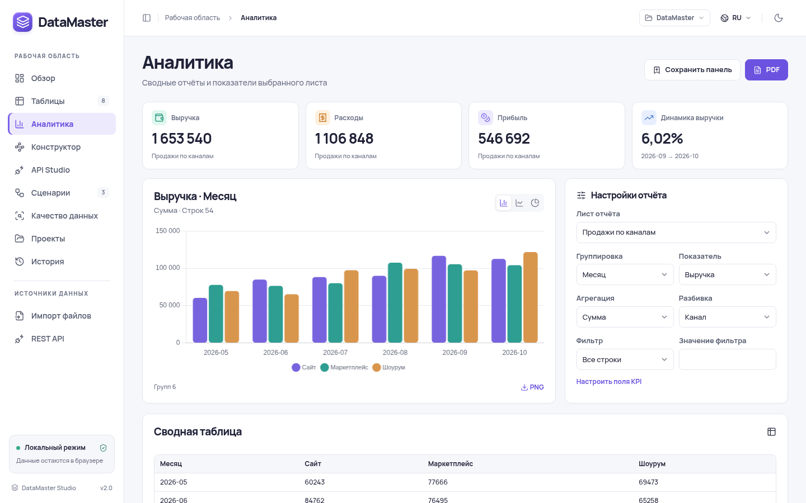

# DataMaster 2.0 для портфолио

DataMaster обрабатывает рабочие книги, выгрузки и ответы API в браузере. Заказчик может проверить правило на одной записи, применить его к таблице целиком и скачать результат. Для демонстрации используются вымышленные товары, компании и операции.

## Видео

В записи закупочная цена кружки `FM-101` меняется с 465 ₽ до 500 ₽. Формула пересчитывает розничную цену до 725 ₽. Готовый прайс скачивается в XLSX и открывается в студии для сверки. В конце показан отчёт по каналам продаж за шесть месяцев. Видео записано в формате 16:9 с русскими подписями. [Смотреть или скачать MP4](DataMaster-Studio-2.mp4)



## Что это даёт бизнесу

- **Контроль расчёта.** Строка формул показывает, как получилась цена. В исходном и итоговом листах можно найти один товар по артикулу и сверить суммы.
- **Повторяемая обработка.** Фильтрацию заказов, сводку по дням и экспорт можно сохранить как сценарий. Промежуточные результаты помогают установить, на каком шаге выбыла нужная запись.
- **Работа с конфиденциальными выгрузками.** Для импорта файлов достаточно открыть приложение на компьютере. Локальное сохранение проектов включается с согласия пользователя. Для прямого запроса к API выбирается адрес источника.

## Материалы для Kwork

| Текст услуги | Какой результат показать | Вложение для карточки |
|---|---|---|
| [Excel и CSV](kwork/01-excel-csv.md) | Две выгрузки с разным порядком столбцов собраны в общий реестр с сохранением номеров накладных. | [Сводный реестр](screenshots/14-consolidated-invoices.png) |
| [Прайс-листы](kwork/02-price-lists.md) | Розничная цена рассчитана из себестоимости. По одному артикулу можно проверить процент наценки и порядок округления. | [Редактор цен](screenshots/03-price-editor.png) |
| [REST API](kwork/03-rest-api.md) | Поля из вложенного ответа JSON попали в таблицу, которую можно выгрузить в Excel. | [Запрос и результат](screenshots/08-api-studio.png) |
| [Бизнес-автоматизация](kwork/04-business-automation.md) | Сохранённая последовательность шагов подготавливает повторную выгрузку по тем же правилам. | [Конструктор](screenshots/09-automation.png) |

Каждый текст содержит описание результата, список входных данных, пример для приёмки и условия выполнения.

## Галерея

Снимки сделаны в рабочем интерфейсе Chromium. Исходные PNG подходят для полноэкранного просмотра.

| Экран | Что на нём можно проверить |
|---|---|
| [Рабочее пространство](screenshots/01-workspace.png) | Стартовый экран с таблицами, бизнес-шаблонами и быстрыми действиями. |
| [Каталог сценариев](screenshots/02-scenarios.png) | Восемь бизнес-шаблонов и готовые последовательности операций. |
| [Редактор прайса](screenshots/03-price-editor.png) | Выделенная розничная цена, строка формул и денежный формат. |
| [Условное форматирование](screenshots/04-formatting.png) | Правило выделения цен выше заданного порога. |
| [Продажи за шесть месяцев](screenshots/05-sales-dashboard.png) | Выручка, расходы, прибыль и столбчатая диаграмма по каналам. |
| [Аналитика в тёмной теме](screenshots/06-dark-analytics.png) | Динамика продаж на линейном графике. |
| [Структура расходов](screenshots/07-financial-report.png) | Круговая диаграмма по статьям и сохранённая панель отчёта. |
| [REST API Studio](screenshots/08-api-studio.png) | Запрос к демонстрационному JSON, статус HTTP 200 и строки реестра отправлений. |
| [Конструктор автоматизации](screenshots/09-automation.png) | Фильтр по статусу оплаты, сводка по дням, экспорт XLSX и промежуточный результат. |
| [Управление проектами](screenshots/10-projects.png) | Два отдельных рабочих проекта и включённое с разрешения локальное сохранение. |
| [Английский интерфейс](screenshots/11-english.png) | Навигация, бизнес-шаблоны и обзор проекта на английском языке. |
| [Мобильный экран](screenshots/12-mobile.png) | Обзор рабочего пространства при ширине экрана 390 пикселей. |
| [Качество клиентской базы](screenshots/13-data-quality.png) | 156 строк, 16 дублей и профиль столбцов. |
| [Пакет Excel и CSV](screenshots/14-consolidated-invoices.png) | Шесть уникальных накладных после объединения двух файлов, включая номера с ведущими нулями. |

## Как переснять материалы

Из корня репозитория выполните команды с установленными Node.js 22.12 или новее, OpenSSL и FFmpeg. Для записи MP4 в FFmpeg нужны libx264 и libass. Шрифт DejaVu Sans используется для русских подписей.

```sh
npm ci
npm run build
npx playwright install chromium
node scripts/capture-portfolio.mjs
```

Переменная `CHROMIUM_PATH` позволяет указать путь к системному Chromium. Скрипт раздаёт содержимое `dist` по временному HTTPS-адресу на loopback, создаёт чистые контексты браузера, записывает действия в интерфейсе и завершает временный сервер. Текст под видео сопровождает запись. Рабочие файлы клиента, токены и внешние API для съёмки не требуются.
